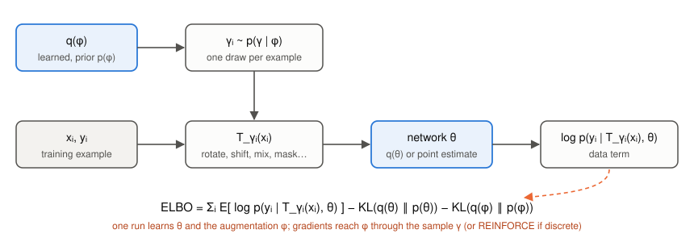
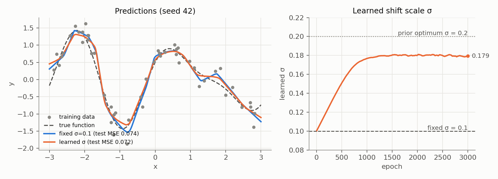
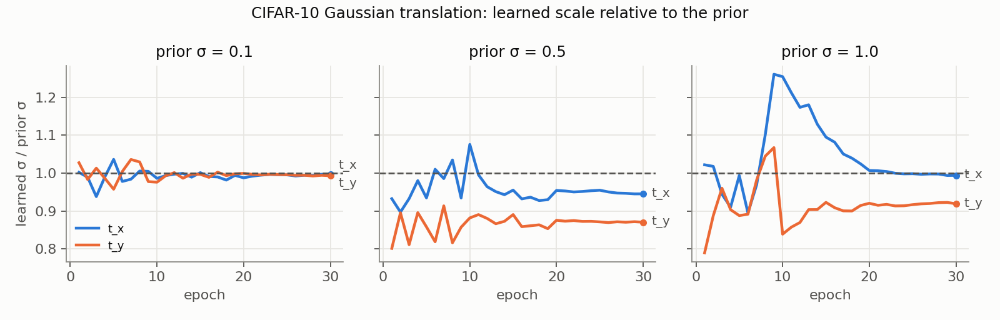
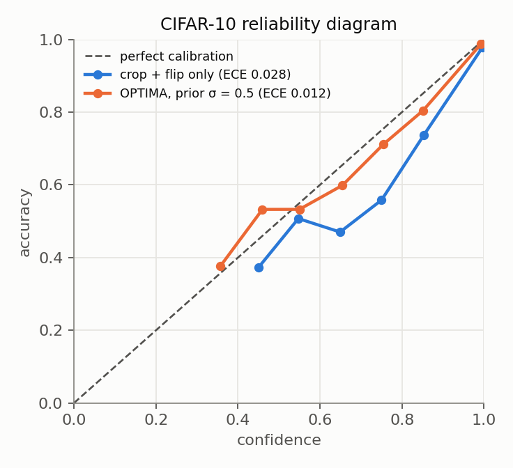
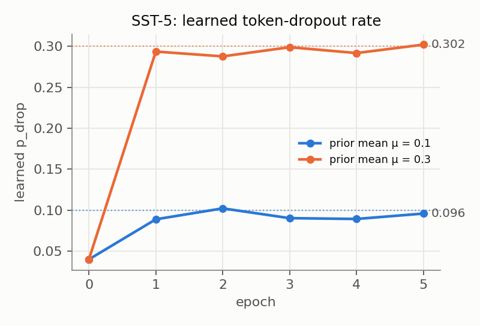

# OPTIMA

Reference implementation of **Optimizing Data Augmentation through Bayesian Model Selection**
(Matymov, Tran, Kampffmeyer, Heinonen, Filippone, ICLR 2026).

OPTIMA treats the parameters φ of an augmentation distribution p(γ | φ) (how far to rotate,
how much to shift, how often to mask a token) as latent variables of the model. It learns them
jointly with the network in **one training run**, by maximising a variational lower bound on
the marginal likelihood. There is no validation-based search over augmentation settings.

<p align="center"></p>

> **Status.** A clean reference implementation. Every experiment in the table below was
> re-run with this code, and the README reports the numbers it produced. Where the paper's
> original scripts were available, they were ported faithfully. In one of them we found and
> fixed a bug; [Reproducibility notes](#reproducibility-notes) lists every departure from the
> paper. The ImageNet experiments (Mixup, CutMix, AugMix; Sec. 5.2 and App. G) are not
> included yet.

**Contents:** [How it works](#how-it-works) ·
[Install](#install) · [Quick start](#quick-start) · [The package](#the-package) ·
[Two objectives](#two-objectives) · [Experiments](#experiments) ·
[Tutorial](#tutorial) · [Reproducibility notes](#reproducibility-notes) ·
[Citation](#citation)

## How it works

Standard augmentation copies each example K times and treats the copies as independent
observations. That raises the likelihood to the power K and overcounts the evidence, which
makes a Bayesian posterior over-confident. OPTIMA instead **averages the likelihood over
transformations**, so each example still counts once:

```math
p(y \mid x, \theta, \phi) = \mathbb{E}_{p(\gamma \mid \phi)}\big[p(y \mid T_\gamma(x), \theta)\big].
```

With a prior p(φ) and a variational posterior q(φ) (and optionally q(θ) for a Bayesian
network), Jensen's inequality gives the **augmented ELBO** (Eq. 7):

```math
\mathcal{L} = \sum_{i=1}^N \mathbb{E}_{q(\theta)\,q(\phi)\,p(\gamma \mid \phi)}\big[\log p(y_i \mid T_\gamma(x_i), \theta)\big] - \mathrm{KL}(q(\theta)\,\|\,p(\theta)) - \mathrm{KL}(q(\phi)\,\|\,p(\phi)).
```

Every training step samples $`\phi \sim q(\phi)`$, then one $`\gamma_i \sim p(\gamma \mid \phi)`$ per example, applies $`T_{\gamma_i}`$, and
backpropagates. If the transformation is differentiable in γ (rotations, shifts, Mixup's λ),
the gradient reaches φ **through the sample**. If it is discrete (token masks), OPTIMA uses a
**score-function (REINFORCE) gradient**.

## Install

```bash
git clone https://github.com/imadik31/OPTIMA.git && cd OPTIMA
pip install -e .                    # core: PyTorch only
pip install -e ".[examples,dev]"    # everything the examples, figures, notebook and tests need
```

Python ≥ 3.9 and PyTorch ≥ 2.0.

## Quick start

```python
import torch
from optima import (AffineAugmenter, BayesianLinear, OptimaObjective,
                    categorical_log_likelihood, train_epoch)

model = my_backbone()                                   # any nn.Module
model.fc = BayesianLinear(512, 10)                      # optional Bayesian last layer
augmenter = AffineAugmenter(init_std=(0.1, 0.1, 0.1))   # learns rotation/translation scales
objective = OptimaObjective(num_train=len(train_set))   # augmented ELBO, per example

optimizer = torch.optim.Adam([
    {"params": model.parameters(), "lr": 1e-4},
    {"params": augmenter.parameters(), "lr": 1e-2},     # augmentation learns faster
])
for epoch in range(30):
    stats = train_epoch(model, augmenter, objective, train_loader, optimizer,
                        categorical_log_likelihood)
    print(stats, augmenter.hyperparameters())
```

## The package

| Module | Contents |
|---|---|
| `optima.hyperparameter` | `HyperParameter`: φ = g(u) with a Gaussian prior and posterior on u. Modes `variational` (q(φ), KL penalty), `map` (point estimate), `fixed` (baseline). Transforms `identity`, `exp`, `softplus`, `sigmoid`. |
| `optima.augmenters` | `GaussianShift` (additive noise), `AffineAugmenter` (rotation and/or translation, optional learned mean), `LearnableMixup` (Beta(α, α)), `TokenDropout` (discrete, REINFORCE), `NoAugmentation`, and `gamma_prior_kl` (see [Two objectives](#two-objectives)). |
| `optima.bayesian` | `BayesianLinear` (mean-field Gaussian, local reparameterisation), `kl_divergence`, `set_sampling`. |
| `optima.objective` | `OptimaObjective` (bounds `elbo`, `multi_sample`, `summed`), `categorical_log_likelihood`, `gaussian_log_likelihood`. |
| `optima.train` | `optima_step`, `train_epoch` (Algorithms 1 and 2 of the paper). |
| `optima.metrics` | MC predictive, accuracy, NLL, ECE, predictive entropy, OOD AUROC. |

**Writing a new augmentation.** Subclass `Augmenter`, store each learnable hyperparameter as
a `HyperParameter`, and return an `AugmentedBatch` from `forward(x, y)`. If the sample is
differentiable in φ, gradients are pathwise. Otherwise set `reparameterized = False` and
return the per-example $`\log p(\gamma_i \mid \phi)`$ in `log_prob`; `OptimaObjective` then adds a REINFORCE
gradient with a leave-one-out baseline. The [tutorial](#tutorial) writes one from scratch.

**Bounds.** With $`\ell_{ik} = \log p(y_i \mid T_{\gamma_{ik}}(x_i), \theta)`$ for $`K`$ augmentation samples per example:

| `bound` | data term | meaning |
|---|---|---|
| `"elbo"` (default) | $`\frac{1}{K}\sum_k \ell_{ik}`$ | the augmented ELBO, Eq. 7 |
| `"multi_sample"` | $`\log \frac{1}{K}\sum_k e^{\ell_{ik}}`$ | tighter; increases with $`K`$ toward $`\log \mathbb{E}_{\gamma}\, p`$ (Eq. 5) |
| `"summed"` | $`\sum_k \ell_{ik}`$ | naive replication, overcounts by $`K`$; baseline only |

`OptimaObjective` returns the loss **per training example**,
$`-\big[\mathrm{mean}_i \,\mathrm{data}_i - (\beta_{\mathrm{net}}\,\mathrm{KL}_{\mathrm{net}} + \beta_{\mathrm{aug}}\,\mathrm{KL}_{\mathrm{aug}})/N\big]`$, so $`\beta = 1`$ gives exactly $`-\mathrm{ELBO}/N`$.
Adding an *unscaled* KL to a mean-reduced loss makes the prior $`N`$ times stronger than the
ELBO implies. That choice largely decides how far the learned φ moves from its prior.

## Two objectives

The repository supports two objectives, and the difference matters.

**1. The augmented ELBO (Eq. 7):** `OptimaObjective`, `Augmenter.kl()`. The prior is on φ.
It is the objective the paper derives and analyses.

**2. The γ-prior objective:** `gamma_prior_kl`, `GaussianShift.kl_to_gamma_prior`,
`AffineAugmenter.kl_to_gamma_prior`, `TokenDropout.quadratic_prior_penalty`. The prior is
on the transformation itself, $`\gamma \sim \mathcal{N}(0, \tau^2)`$, and the penalty $`\mathrm{KL}(\mathcal{N}(\mu, \sigma^2) \,\|\, \mathcal{N}(0, \tau^2))`$ is added
**with full weight** to a mean-reduced loss. It is an exact ELBO for a model where every
example has its own latent transformation $`\gamma_i`$, with $`q(\gamma_i) = p(\gamma \mid \phi)`$. Its optimum is $`\sigma = \tau`$.
**This is the objective the paper's experiments used** (Sec. 5.1, 5.4, App. F.2), and the
examples use it to reproduce them.

They behave differently. With a point-estimate network, the training-data term almost
always prefers *less* augmentation. Under Eq. 7 the learned scale therefore shrinks toward
zero: we see this on the synthetic task, on CIFAR-10 and in the tutorial. Under the γ-prior
objective, the prior holds the scale near τ and the data adjusts it within a few percent.
In both cases the prior sets the scale of augmentation, so choose it deliberately; the
experiments below vary it. Learning the scale from the data under Eq. 7 needs an Occam
factor over the network weights (a posterior q(θ), Algorithm 1). This is the same reason
marginal-likelihood invariance learning (van der Wilk et al., 2018; Immer et al., 2022)
needs one.

## Experiments

All numbers were produced with this repository. Each table states the seeds and setup;
everything runs on a single GPU (P100, 1080 Ti or A100), and the commands are below.

| Paper | Augmentation | Script | Status |
|---|---|---|---|
| Sec. 5.1, Fig. 2 | Gaussian input shift | `examples/synthetic_regression.py` | port of original, **reproduces Fig. 2 exactly** |
| App. F.2, Table 6 | Gaussian translation | `examples/cifar10_translation.py` | port of original **with a bug fixed**; conclusions hold |
| App. F.1, Table 5 | rotation + translation | `examples/cifar10_affine.py` | reimplementation; ordering reproduced, absolute numbers differ |
| Sec. 5.4, Table 4 | token dropout (discrete) | `examples/sst5_token_dropout.py` | reimplementation; pattern reproduced |
| Sec. 5.2, App. G | Mixup, CutMix, AugMix (ImageNet) | not included yet | |

### Synthetic regression (Sec. 5.1, Fig. 2)

```bash
python examples/synthetic_regression.py --seed 42      # about 2 minutes on a CPU
```

| seed 42 | train MSE | test MSE | σ |
|---|---|---|---|
| no augmentation | 0.021 | 0.102 | n/a |
| fixed σ = 0.1 | 0.039 | 0.074 | 0.1 |
| naive, K = 5 | 0.039 | 0.073 | 0.1 |
| learned (γ-prior, τ = 0.2) | 0.047 | 0.072 | **0.179** |

These match Fig. 2 of the paper within 0.001.



Learned σ reaches about 0.18 for every seed tried. The test-MSE comparison with fixed σ
depends on the seed (learned wins at seed 42, loses at seeds 0 and 1). See
[the notes](#synthetic-regression-sec-51) for what drives the widening.

### CIFAR-10, learned Gaussian translation (App. F.2, Table 6)

Pretrained ResNet-18 (CIFAR stem) with a Bayesian last layer and crop + flip for every
method. The learned translation acts on top. Final-epoch model, 30 MC samples, SVHN as OOD.

```bash
python examples/cifar10_translation.py --method none   --data ./data
python examples/cifar10_translation.py --method fixed  --prior-sigma 0.5 --data ./data
python examples/cifar10_translation.py --method optima --prior-sigma 0.5 --data ./data
```

| seed 42 | Acc (%) | NLL | ECE ↓ | SVHN AUROC ↑ | learned σ (t_x, t_y) |
|---|---|---|---|---|---|
| crop + flip only | **94.14** | 0.207 | 0.0283 | 0.912 | n/a |
| OPTIMA, prior 0.1 | 93.95 | 0.206 | 0.0262 | 0.932 | 0.100, 0.099 |
| fixed σ = 0.5 | 93.27 | 0.207 | **0.0089** | 0.958 | n/a |
| **OPTIMA, prior 0.5** | 93.49 | **0.194** | 0.0116 | **0.960** | 0.473, 0.435 |
| fixed σ = 1.0 | 89.65 | 0.306 | 0.0086 | 0.933 | n/a |
| **OPTIMA, prior 1.0** | 90.88 | 0.264 | **0.0044** | 0.937 | 0.994, 0.919 |

About 15–20 minutes per run.

* **Translation augmentation improves calibration and OOD detection a lot** (ECE 0.028 →
  0.012, AUROC 0.912 → 0.960 at prior 0.5) at a small cost in accuracy. The paper reports
  the same trade-off.
* **Learning σ, rather than fixing it at the prior value, helps modestly.** It helps most at
  prior 1.0, where the learned vertical scale shrinks: +1.2 points accuracy, NLL 0.306 → 0.264,
  ECE 0.0086 → 0.0044. At prior 0.5, OPTIMA has the better NLL and AUROC and fixed σ the
  better ECE. These are single-seed results.
* **The data shapes the augmentation, within limits.** Vertical shifts are consistently
  pulled below horizontal ones (CIFAR objects are vertically centred). The learned σ stays
  within about 13% of the prior.



<p align="center"></p>

### CIFAR-10, learned rotation + translation (App. F.1, Table 5)

Reimplementation from the paper's description (the original script was not available):
ResNet-18 trained from scratch with a Bayesian last layer, no crop/flip, Adam (1e-4 network,
1e-2 augmentation), 30 epochs, 100 MC samples. [The notes](#cifar-10-rotation--translation-app-f1)
list the choices the paper leaves open.

```bash
python examples/cifar10_affine.py --method optima --data ./data   # also: none, fixed
```

| seed 42 | Acc (%) | NLL | ECE ↓ | SVHN AUROC ↑ |
|---|---|---|---|---|
| no augmentation | 68.03 | 1.812 | 0.229 | 0.713 |
| fixed (ω, t_x, t_y all σ = 0.1) | 82.33 | 0.755 | 0.105 | **0.829** |
| **OPTIMA** (prior 0.1) | **83.90** | **0.629** | **0.091** | 0.828 |
| *paper, OPTIMA* | *81.35* | | *0.017* | |

About 20 minutes per run. The ordering matches Table 5: OPTIMA beats fixed augmentation on
accuracy, NLL and ECE. Absolute numbers differ, because the paper's No Aug run reaches 80.9%
and its OPTIMA ECE is far lower. The learned scales stay at about 0.098, close to the
fixed 0.1, so the gap to fixed augmentation does not come from a different scale. With one
seed we cannot say how much of it is noise.

### SST-5, learned token dropout (Sec. 5.4, Table 4)

DistilBERT, 5 epochs. Token dropout $`p_{\mathrm{drop}} = 0.5\,\mathrm{sigmoid}(s)`$ has a Gaussian prior $`\mathcal{N}(\mu, 0.1^2)`$
directly on $`p_{\mathrm{drop}}`$, and $`s`$ is learned with REINFORCE.

```bash
python examples/sst5_token_dropout.py --method optima --prior-mean 0.3 --seed 0
python examples/sst5_token_dropout.py --method fixed --p 0.3 --seed 0
```

| 3 seeds, mean ± sd | Accuracy | NLL ↓ | ECE ↓ | learned p_drop |
|---|---|---|---|---|
| no augmentation | 0.517 ± 0.001 | 1.515 ± 0.011 | 0.288 ± 0.001 | n/a |
| fixed p = 0.04 (= OPTIMA init.) | 0.521 ± 0.006 | 1.375 ± 0.010 | 0.247 ± 0.005 | n/a |
| OPTIMA, μ = 0.1 | 0.517 ± 0.013 | 1.287 ± 0.020 | 0.215 ± 0.015 | 0.088 |
| fixed p = 0.088 (matched) | 0.515 ± 0.001 | 1.285 ± 0.007 | 0.219 ± 0.006 | n/a |
| fixed p = 0.3 | 0.520 ± 0.009 | **1.124 ± 0.007** | **0.108 ± 0.006** | n/a |
| OPTIMA, μ = 0.3 | **0.524 ± 0.005** | **1.124 ± 0.007** | **0.108 ± 0.002** | 0.298 |

About 5 minutes per seed. As in Table 4, accuracy barely changes and token dropout improves
NLL and calibration. **OPTIMA matches a fixed p_drop at the value it learns**, and that value
stays close to the prior mean μ. Here, as in the paper, the benefit comes from the dropout
level the prior selects, found in one run. Our NLL and ECE are higher than the paper's
across all methods; one plausible cause is that our plain training loop differs from the
HuggingFace `Trainer` in some defaults (not checked).



### Rebuilding the figures

Each example writes its metrics and training history with `--out run.json`.
`scripts/make_figures.py` turns a directory of these into the figures above:

```bash
python examples/synthetic_regression.py --seed 42 --out runs/synthetic/seed42.json
python examples/cifar10_translation.py --method optima --prior-sigma 0.5 \
    --out runs/t_opt_p0.5/seed42.json --data ./data
python scripts/make_figures.py --runs runs --out docs/figures
```

## Tutorial

[`notebooks/tutorial.ipynb`](notebooks/tutorial.ipynb) runs on a CPU in a few minutes and
covers:
- the augmenter API;
- the two objectives side by side, showing σ collapse under Eq. 7 and staying near τ under
  the γ-prior objective;
- writing a learnable augmentation from scratch;
- training a small classifier with `BayesianLinear` and reading its calibration metrics.

## Reproducibility notes

This section records, in full, where the code that produced the paper's numbers departs from
the paper's text, and what this repository does about it. None of it touches the method's
derivation or the theory.

### Synthetic regression (Sec. 5.1)

The example ports the original script exactly, and `--seed 42` reproduces Fig. 2. The paper
says the shift "has a prior N(0, 0.2²)". In the script that prior is on the shift γ itself:
the loss is `MSE + KL(N(μ, σ²) ‖ N(0, 0.2²))` with (μ, σ) point estimates. That is the
γ-prior objective of [Two objectives](#two-objectives), an exact ELBO for a per-example
latent shift under a Gaussian likelihood of variance 0.5. It is not Eq. 7. Two things follow
that the paper does not spell out:

* The widening of σ from 0.10 to about 0.18 is driven mainly by the prior, whose optimum is
  σ = 0.2. The paper attributes it to the data (Corollaries 4.2 and 4.15).
* Under Eq. 7 with a point-estimate network (`OptimaObjective`), σ shrinks to about 0.015 on
  this problem, and the best fixed σ for test MSE is about 0.1.

### CIFAR-10 Gaussian translation (App. F.2)

The original script (`bayesian_data_aug_cifar10.py`) has two bugs in its learnable mode:

1. **The augmentation parameters never received a gradient from the data.** The translation
   matrix was built with `torch.tensor([[1, 0, tx], [0, 1, ty]])`, which copies `tx, ty` and
   detaches them from the graph. Only the KL term moved (μ, σ), so σ went to exactly the
   prior value and μ stayed at 0. Table 6's OPTIMA rows are therefore fixed Gaussian
   translations with σ equal to the prior. This repository builds the matrix with
   `torch.stack`, so gradients flow; a test checks this.
2. **The learnable mode cannot run as written.** The optimiser received a list mixing tensors
   and a parameter-group dict, which PyTorch rejects. The version that produced Table 6 must
   have differed slightly.

We re-ran the original script with both bugs fixed (prior σ 0.5 and 1.0, all other settings
unchanged). The conclusions of Table 6 hold, and the prior-0.5 row matches or improves on the
paper:

| original script, fixed, seed 42 | Acc (%) | ECE ↓ | SVHN AUROC ↑ |
|---|---|---|---|
| No Aug (paper: 94.09 / 0.0381 / 0.9069) | 94.02 | 0.0403 | 0.9046 |
| OPTIMA, prior 0.5 (paper: 93.87 / 0.0165 / 0.9576) | 94.14 | 0.0165 | 0.9706 |
| OPTIMA, prior 1.0 (paper: 90.25 / 0.0175 / 0.9647) | 92.46 | 0.0054 | 0.9529 |

The paper's prior-0.1 row (93.30 / 0.0192 / 0.9446) did not reproduce: the original script
gives 94.49 / 0.0333 / 0.9114 as written and 94.12 / 0.0355 / 0.9233 with the fix. Also, the original keeps a reference
to `model.state_dict()` rather than a copy, so its "best model" is the final model, and its
reported numbers come from the last epoch. This repository evaluates the last epoch
explicitly.

### CIFAR-10 rotation + translation (App. F.1)

The original script was not available, so `cifar10_affine.py` follows App. F.1 where it is
specific and makes these choices where it is not:
- ResNet-18 with a CIFAR stem, trained from scratch, no crop/flip;
- the γ-prior objective with τ = 0.1 per component and initial σ = 0.05;
- $`\beta_{\mathrm{net}} = 0.1`$ applied to $`\mathrm{KL}/N`$. A literal 0.1 × the full KL would swamp the cross-entropy.

### SST-5 token dropout (Sec. 5.4, App. H)

The original script was not available. App. H states $`s_0 = -2`$ and an initial $`p_{\mathrm{drop}} \approx 0.04`$;
with $`p_{\max} = 0.5`$ these disagree ($`0.5\,\mathrm{sigmoid}(-2) \approx 0.06`$). The example starts at 0.04, the
paper's fixed baseline. "HuggingFace defaults" is read as AdamW, batch size 8, linear decay,
no warm-up and no weight decay. The prior on p_drop is added unscaled to the mean
cross-entropy.

### Not included

ImageNet / ImageNet-C with Mixup, CutMix and AugMix (Sec. 5.2, App. G), and the
Bayesian-optimisation comparison (Sec. 5.3). `LearnableMixup` is in the package; CutMix and
AugMix augmenters are not.

## Repository layout

```
src/optima/            the package
examples/              one script per experiment (see Experiments)
notebooks/tutorial.ipynb
scripts/make_figures.py
docs/figures/          figures used in this README
tests/                 pytest suite
```

## Tests

```bash
pytest
ruff check .
```

## Citation

```bibtex
@inproceedings{matymov2026optimizing,
  title     = {Optimizing Data Augmentation through Bayesian Model Selection},
  author    = {Matymov, Madi and Tran, Ba-Hien and Kampffmeyer, Michael and
               Heinonen, Markus and Filippone, Maurizio},
  booktitle = {International Conference on Learning Representations},
  year      = {2026}
}
```

## License

MIT, see [LICENSE](LICENSE).
